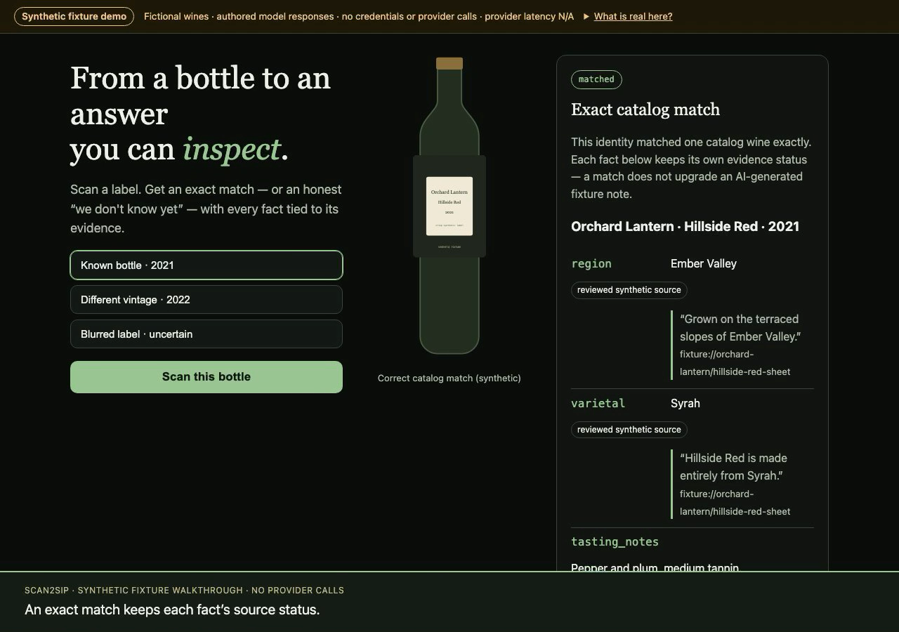

# scan2sip

**From a bottle to an answer you can inspect.**

Wine apps usually ask you to trust the card. scan2sip demonstrates the
opposite: scan a label, get an exact match — or an honest “we don't
know yet” — and inspect the evidence behind every fact. A synthetic
producer document flows through quoted-evidence staging, review, and
atomic publication, after which the same bottle rescans as a match and
answers questions from its own published revision, with citations.

Everything is a **local, no-credential, synthetic fixture**: fictional
wines, authored model responses, and simulated failures. Matching,
uncertainty, deduplication, attribution, publication, and chat run as
real local code. One review artifact (Glassfinch) has been
independently reviewed and hash-pinned; all other review in the demo
is clearly labeled simulated playback.

[](demo/scan2sip-walkthrough.mp4)

**[Watch the 65-second walkthrough](demo/scan2sip-walkthrough.mp4)**
(recorded from the actual Chrome UI on synthetic fixtures; chapter
list and provenance in [`demo/README.md`](demo/README.md)).

## Run it

Requires **Node 24.22.0** (`.nvmrc`; `nvm use` works):

```bash
npm ci
npm start        # http://127.0.0.1:4173
npm test         # automated tests (browser tests need system Chrome, or skip)
npm run eval     # deterministic fixture evaluator -> evaluation/results.json
npm run eval:check   # verify committed results still reproduce exactly
```

No credentials, no network calls in fixture mode, no database service —
state is one disposable SQLite file under `data/` (reset from the UI).

## Three-minute walkthrough

1. **Scan the known bottle** (Orchard Lantern 2021) → exact match;
   notice each field's status: reviewed synthetic source vs.
   AI-generated fixture vs. **Unknown**.
2. **Try the 2022 vintage and the blurred label** → no year is ever
   substituted; uncertainty stays provisional and only records local
   research demand.
3. **Scan the unknown Glassfinch**, then open the **Evidence flow**:
   view its local source sheet, stage it (the grilled-peaches pairing
   is visibly *unsupported*), and play the simulated review — or load
   the independently reviewed artifact (reviewed by a separate AI
   reviewer, “S”, who checked the synthetic source and its bindings —
   not human producer verification) — and publish.
4. **Rescan the Glassfinch** → it now matches; **Ask this wine** where
   it's from and what grape it is (cited, exact revision), then ask
   about food pairing (honest unknown).
5. **Explore the fictional regions** (synthetic schematic, not a map)
   and open the Inspector for all ten scenarios, replay/reset
   diagnostics, and raw JSON.

## What this demo proves — and doesn't

Proves: identity/uncertainty semantics, evidence-bound publication,
review classification that survives into chat citations, and
replay-safe writes, all against authored fixtures. It does **not**
claim model accuracy, provider performance, or search quality;
provider latency is N/A in fixture mode. See
[`docs/PROVENANCE-AND-LIMITS.md`](docs/PROVENANCE-AND-LIMITS.md).

## Documentation

- [`docs/ARCHITECTURE.md`](docs/ARCHITECTURE.md) — flow, trust boundaries, file map, tradeoffs
- [`docs/CONTRACT.md`](docs/CONTRACT.md) — scope and normative behavior contract
- [`evaluation/results.json`](evaluation/results.json) — committed deterministic evaluation (14 cases)
- [`docs/DEPENDENCIES.md`](docs/DEPENDENCIES.md) — dependency/license inventory from the exact lock
- [`docs/SOURCE-INVENTORY.md`](docs/SOURCE-INVENTORY.md) · [`docs/FIXTURE-MANIFEST.md`](docs/FIXTURE-MANIFEST.md) — provenance

## Status

At the accepted milestone-2 checkpoint the suite is **44 automated
tests** (Node tests plus system-Chrome browser regressions via CDP;
browser tests skip cleanly where Chrome is unavailable, so counts in
other environments may show skips — final counts are confirmed at
release review). This repository is a portfolio showcase, not a
product: no hosting, accounts, live providers, or paid calls. Its own
license is intentionally undecided until the final rights review —
no `LICENSE` file yet, and none should be assumed.
