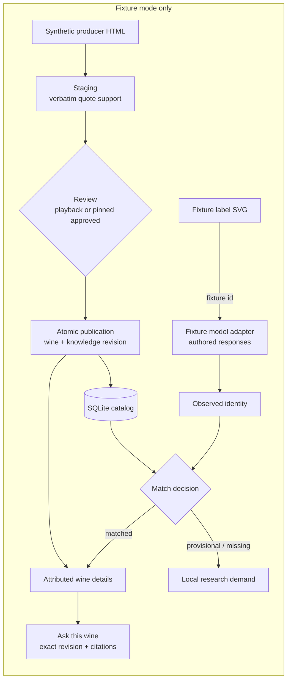

# scan2sip — architecture

A local, no-credential, synthetic-fixture demonstration of a
scan-to-knowledge flow. One Node 24 process serves a loopback Express
API, a vanilla browser UI, and one SQLite file (`node:sqlite`).

## Trust boundaries

- **Model output is untrusted.** Fixture responses are authored data;
  identity projection bounds and validates them. Confidence is a
  signal, never a calibrated probability; uncertain observations stay
  provisional even when one candidate exists.
- **Quotes are evidence, values need entailment.** Staging checks that
  supporting quotes exist verbatim; acceptance is a review decision.
  An unsupported field can never be accepted or published.
- **Review status is earned, not declared.** A review is
  independently-reviewed only when its canonical digest equals the
  server-side pin of the exact S-approved artifact
  (`PINNED_INDEPENDENT_REVIEW_DIGEST`). Everything else is labeled
  simulated playback, and that classification travels with published
  fields, knowledge rows, and chat citations.
- **Publication is atomic and deduplicating.** One SQLite transaction
  writes wine + publication record + knowledge revision; replay finds
  the recorded publication before any freshness check, and duplicates
  change no fields or provenance.
- **Unknown stays unknown.** Missing fields render as Unknown; a
  missing vintage is never a year wildcard and never “NV”; chat
  answers unknown when the exact wine revision has no evidence.

## File map

| Path | Role |
|---|---|
| `src/core/identity.js`, `observation.js`, `matching.js` | Canonical identity keys, observation projection, match decision |
| `src/core/digest.js` | Canonical SHA-256 digests for all bindings |
| `src/adapters/fixtureModel.js` | Authored fixture responses; distinct simulated failures |
| `src/service.js` | Scan orchestration: decision, replay/conflict, demand |
| `src/ingestion.js` | Staging, review import/classification, publication, chat |
| `src/store.js` | SQLite tables and transactions |
| `src/fixtureIntegrity.js` | Manifest schema/hash verification; fail-closed startup |
| `src/server.js` | Express API, seed knowledge, pinned review digest, region data |
| `web/` | Vanilla UI: hero scan, evidence flow, ask-this-wine, region explorer, inspector |
| `fixtures/` | Catalog, labels, responses, synthetic documents, proposals, review artifacts, manifest |
| `evaluation/` | Deterministic evaluator and committed results |
| `tests/` | Node tests + system-Chrome browser regressions (CDP) |

## Tradeoffs

- `node:sqlite` avoids a database service and native builds; it is a
  young built-in API, so storage sits behind `src/store.js` and could
  be swapped for a pinned driver without touching domain code.
- Lexical/exact-revision retrieval replaces embeddings/vectors on
  purpose: the demo proves evidence plumbing, not search quality.
- A single provider gateway and live mode were deliberately cut;
  fixture mode is the product of this demo.
- The demo clock is pinned so review expiry is deterministic in
  tests and recordings; it is always labeled a fixture clock.
